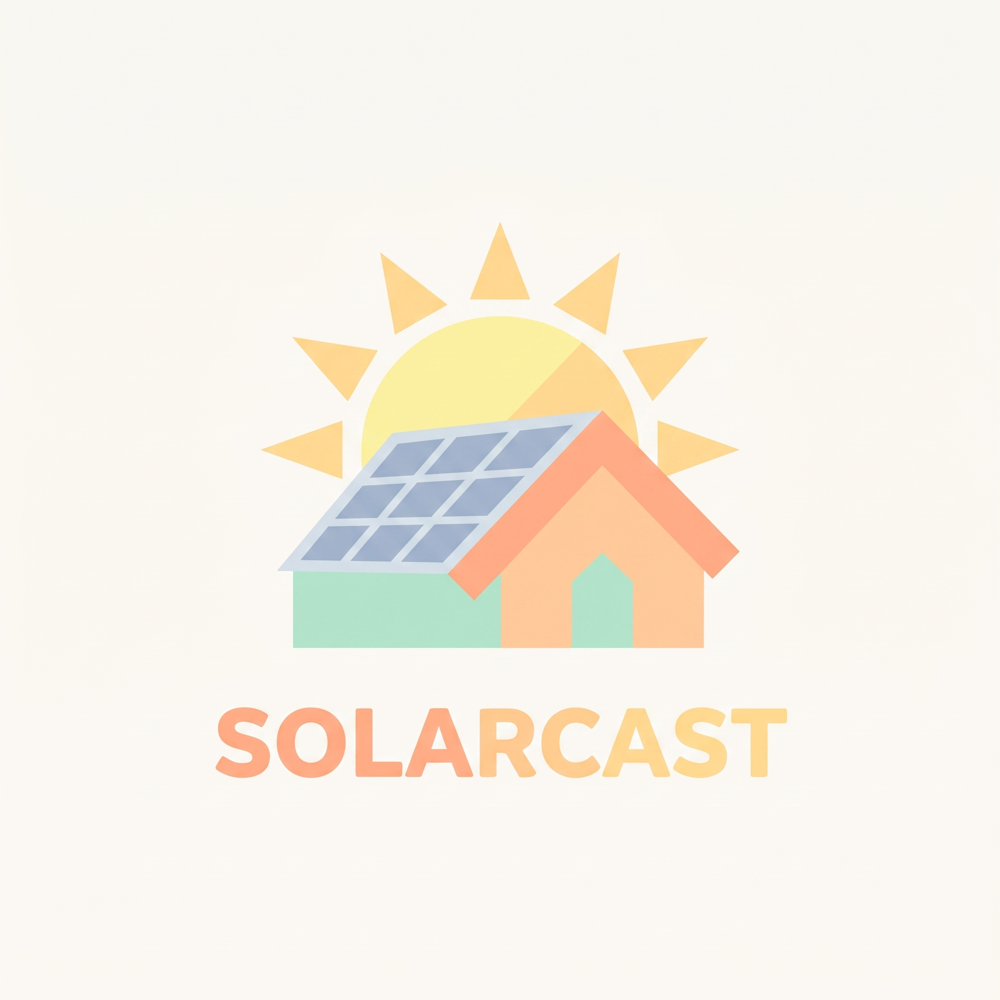

# SolarCast



[](https://github.com/alex-rs/solar-cast/actions/workflows/backend-tests.yml)
[](https://github.com/alex-rs/solar-cast/actions/workflows/hassfest.yml)
[](https://github.com/alex-rs/solar-cast/actions/workflows/hacs-validate.yml)
[](#mcp-server-optional)
[](LICENSE)
[](backend/pyproject.toml)
[](https://hacs.xyz/)

Self-hosted PV production forecasting: a FastAPI backend that blends Open-Meteo
ensemble weather with `pvlib` physics, plus a Home Assistant (HACS) integration
that feeds the Energy dashboard.

## Quick start

```sh
cd backend
uv sync
uv run uvicorn app.main:app --port 8000
```

Register a system:

```sh
curl -X PUT http://localhost:8000/api/v1/systems/home \
  -H 'content-type: application/json' \
  -d '{"name":"Home","lat":44.8125,"lon":20.4612,"inverter_kw":5.0,
       "planes":[{"dec":30,"az":0,"kwp":5.0}]}'
```

Forecast: `GET /api/v1/systems/home/forecast?resolution=60&days=7`.
Forecast.Solar-compatible: `/estimate/{lat}/{lon}/{dec}/{az}/{kwp}`.

Docker: `cd backend && docker compose up -d`.

### MCP server (optional)

`ENABLE_MCP=true` exposes a read-only MCP server (Streamable HTTP) at
`http://localhost:8000/mcp`; it is disabled by default and `/mcp` is then a
plain 404. Docker Compose ships the switch, defaulting to `false`, in
`backend/docker-compose.yml`:

```yaml
environment:
  - API_TOKEN=change-me
  # set true to expose the read-only MCP server at /mcp
  - ENABLE_MCP=false
```

Set `API_TOKEN` and pass `Authorization: Bearer <token>` — with an empty
`API_TOKEN` the endpoint is unauthenticated, like the rest of the API.

Tools:

- `list_systems` returns `{"systems": [{"system_id", "name", "timezone", "lat", "lon", "kwp_total"}]}`.
- `get_forecast(system_id, days=3, resolution=60, layer="final")` returns the
  native forecast payload. `days` is 1-7, `resolution` is 15 or 60, and `layer`
  is `final`, `hybrid`, `physics` or `physics_base`.

The server is read-only: no system CRUD, telemetry or retraining.

```json
{
  "mcpServers": {
    "solarcast": {
      "url": "http://localhost:8000/mcp",
      "headers": {"Authorization": "Bearer <API_TOKEN>"}
    }
  }
}
```

## How the forecast works

### High level

1. **Weather.** Pull 15-minute GHI, DNI, DHI, temperature and wind for several
   Open-Meteo models, plus hourly cloud, precipitation, snowfall and snow depth.
2. **Blend.** Combine the models with configured or learned weights, then
   enforce physical radiation closure (`GHI = DHI + DNI·cos θz`).
3. **Geometry.** Compute solar position, block beam radiation below the terrain
   or learned horizon, apply learned beam shading, and transpose radiation onto
   each plane with the Perez sky model.
4. **Conversion.** Apply incidence-angle and snow losses, estimate cell
   temperature, convert plane-of-array irradiance to DC power, and clip each
   inverter group to its AC limit.
5. **Learning.** Calibrate a clear-sky scale factor `C`, learn a beam-shading
   map `K(azimuth, elevation)` from clear days, train a LightGBM model-output
   statistics (MOS) model on physics residuals, and apply a short-lived
   persistence nowcast from the latest telemetry.
6. **Energy.** Integrate instantaneous power with the trapezoid rule into
   15-minute energy periods, then sum into hourly, daily and compatibility
   payloads.

### Weather blending

For model `m` and variable `x`, the blended value at time `t` is the weighted
average of the models that provide that variable:

$$
\bar{x}_t = \frac{\sum_m w_m x_{m,t} \mathbf{1}_{m,t}}
                 {\sum_m w_m \mathbf{1}_{m,t}}
$$

Default weights are `0.50`, `0.35`, `0.15`. After blending, the radiation
components are made consistent:

$$
GHI_t = DHI_t + DNI_t \cos \theta_{z,t}
$$

where `θz` is the apparent solar zenith angle. Hourly precipitation and snowfall
are split evenly across the four 15-minute bins preceding each hourly timestamp.

### Learned model weights

Weights are fitted per rounded location (`0.001°`) from the last 60 days of
15-minute telemetry. For each valid period:

$$
k_{actual} = \frac{P_{measured,15}}{P_{clear,15}}, \qquad
k_{model} = \frac{GHI_{model}}{GHI_{clear}}
$$

The weights solve a non-negative least-squares problem:

$$
w = \arg\min_{w \ge 0} \lVert Xw - y \rVert_2,
\qquad \sum_m w_m = 1
$$

Only non-curtailed periods with `P_clear > 0`, elevation above 5°, and measured
power within 105% of the AC limit are used. Learning requires at least 200
samples across at least 10 local days. New weights replace the defaults only if
their mean absolute error is at most `0.99×` the default-weight MAE; otherwise
the previous weights remain. Learning runs during the nightly retrain and the
weather cache is refreshed immediately after.

### Solar geometry, horizon and shading

Solar position comes from `pvlib`'s SPA implementation. Terrain and user horizon
points define a horizon elevation `h(azimuth)`. Beam radiation is removed when
the sun is below it:

$$
DNI_{eff} = DNI \cdot \mathbf{1}\left[e > h(a)\right]
$$

User-uploaded horizons take precedence over the PVGIS terrain horizon. A learned
beam-shading factor `K(a, e)` is then applied:

$$
DNI_{eff} \leftarrow K(a,e)\, DNI_{eff}
$$

`K` is stored on a 5° azimuth by 2° elevation grid. For each cell, measured and
retrospective clear-sky power give

$$
K = \mathrm{clip}\left(
\frac{P_{measured}/(C\,P_{clear}) - f_d}{f_b},\, 0,\, 1.1
\right)
$$

where `f_b` and `f_d` are the beam and diffuse fractions. Cells need at least
three samples on two distinct clear days, and are shrunk toward full transmission:

$$
K_{shrunk} = \frac{n \bar{K} + 3}{n + 3}
$$

### Plane-of-array irradiance

Each plane is described by tilt `dec` and Forecast.Solar azimuth `az`
(0° = south, −90° = east, +90° = west). The plane-of-array irradiance uses the
Perez model:

$$
E_{POA} = E_b + E_{sky} + E_{ground}
$$

with beam incidence `cos θAOI`, an ASHRAE incidence-angle modifier for beam
radiation, and Marion modifiers for sky and ground diffuse radiation. Snow
coverage `s` from the NREL model reduces both beam and diffuse components:

$$
E_{POA} \leftarrow (1-s)E_{POA}
$$

Ground albedo is `0.60` when snow depth exceeds `0.02 m`, otherwise `0.20`.
Night periods are forced to zero.

### DC power and inverters

Cell temperature uses the Faiman model with ambient temperature and wind speed.
DC power for a plane is

$$
P_{dc} = P_{dc,0}\frac{E_{POA}}{1000}
\left[1 + \gamma_{pdc}(T_c - 25)\right]
(1 - L_{sys})\, d(t)
$$

where `Pdc,0 = kWp × 1000 × C`, `γpdc` defaults to `−0.004 /°C`, `Lsys` is the
system loss (default 10%), and `d(t)` is the optional morning/evening damping
factor. Damping falls linearly from the sunrise-to-transit and transit-to-sunset
spans and is clipped to `[0, 1]`.

Planes are grouped by inverter. Each group is clipped independently:

$$
P_{ac} = \mathrm{clip}\left(
\mathrm{PVWattsInverter}(P_{dc,group}, P_{aco}),\,
0,\, P_{aco}
\right), \qquad P_{aco} = ac\_kW \times 1000
$$

The inverter curve uses `Pdc0 = Paco / 0.96` and `ηnom = 0.96`. Planes without
an inverter assignment form a virtual group whose AC limit is the sum of their
kWp values. The system AC output is the sum of all group outputs; a configured
inverter with no planes contributes no limit.

### Clear-sky calibration

`C` scales the DC model against measured clear-sky production. A day qualifies
when it has at least four daylight samples, at least 80% valid periods, four
high-sun samples above 20° elevation, a median measured/clear-sky ratio of at
least 0.6, and a coefficient of variation below 0.15. The factor is the median
of high-sun, beam-dominated ratios over at least three clear days:

$$
C = \mathrm{clip}\left(\mathrm{median}\left[
P_{measured} / P_{clear}\right],\, 0.6,\, 1.2\right)
$$

Telemetry marked as curtailed or snow-affected is excluded.

### MOS residual model

A LightGBM regressor learns the normalized residual between measured and
physics power:

$$
r(x) = \frac{P_{measured} - P_{physics}}{kWp_{total} \times 1000}
$$

Features include normalized physics and clear-sky power, forecast clear-sky
index, cloud cover at four layers, temperature, wind, solar zenith and azimuth,
lead time, day of year, days since rain, and snow depth. The model uses 300
trees, learning rate `0.03`, depth `4`, 15 leaves, and at least 30 days of
training data with the last 7 days held out. It is kept only if the hybrid nMAE
improves on physics by at least 2%:

$$
nMAE_{hybrid} \le 0.98\, nMAE_{physics}
$$

The hybrid output is

$$
P_{hybrid} = \mathrm{clip}\left(
P_{physics} + r(x)\, kWp_{total} \times 1000,\,
0,\, P_{aco}
\right)
$$

and is zero wherever the base physics output is zero.

### Three-hour nowcast

Telemetry periods that ended within the last 45 minutes are converted to
clear-sky indices, at most four of them, and each bucket contributes its own
bias:

$$
\Delta k_i = \mathrm{clip}\left(P_{meas,i}/P_{clear,i},\, 0,\, 1.5\right)
- \mathrm{clip}\left(P_{fc,i}/P_{clear,i},\, 0,\, 1.5\right)
$$

The applied bias is the median over those buckets, anchored at the newest
usable bucket `t_0`:

$$
\Delta k = \mathrm{median}(\Delta k_i)
$$

$$
k(t) = k_{fc}(t) + \Delta k \, e^{-(t-t_0)/90}
$$

$$
P_{final} = \mathrm{clip}\left(k(t) P_{clear}(t),\, 0,\, P_{aco}\right)
$$

`90` is the decay time constant in minutes. The median keeps one passing cloud
from flattening the whole window; with a single usable bucket the expression
reduces to the measured bias of that bucket. Night periods and periods without
a clear-sky reference remain zero.

### Period energy and labels

Instantaneous power is integrated with the trapezoid rule:

$$
E_i = \frac{P_i + P_{i+1}}{2} \times 0.25\ \text{Wh}
$$

for 15-minute periods. Hourly values are sums of four 15-minute periods; daily
values are sums by local calendar date. Native API periods are labeled by their
start timestamp. The Forecast.Solar-compatible endpoint labels periods by their
end timestamp, matching that API's convention.

## Home Assistant

Install through HACS as a custom repository, then add the **SolarCast**
integration and point it at the backend URL. The integration registers the
system, polls the forecast and (optionally) pushes your PV energy meter back as
telemetry for calibration and shading learning.

### Correcting recorded production

Pushed telemetry outranks backfill, and a user correction outranks both: rows
written with `origin=manual` survive later pusher and backfill ticks. Correct
one period, or delete a useless range, from an automation or Developer Tools:

```yaml
service: solarcast.set_telemetry
data:
  config_entry_id: <entry_id>
  period_start: "2026-11-10T10:00:00+01:00"
  energy_wh: 1234.5
  curtailed: false
```

```yaml
service: solarcast.delete_telemetry
data:
  config_entry_id: <entry_id>
  start: "2026-11-09T00:00:00+01:00"
  end: "2026-11-10T00:00:00+01:00"
```

The same operations without Home Assistant:

```sh
curl -X POST http://localhost:8000/api/v1/systems/home/telemetry \
  -H "Authorization: Bearer $API_TOKEN" -H 'content-type: application/json' \
  -d '{"origin":"manual","items":[{"period_start":"2026-11-10T09:00:00Z","period_min":15,"energy_wh":1234.5}]}'

curl -X DELETE "http://localhost:8000/api/v1/systems/home/telemetry?start=2026-11-09T00:00:00Z&end=2026-11-10T00:00:00Z" \
  -H "Authorization: Bearer $API_TOKEN"
```

Calibration, shading and the MOS model pick the correction up at the next
nightly retrain (01:30 local); the intraday nowcast only uses the last 45
minutes of telemetry. A metric-replacement or export-limited day is usually
better deleted than zeroed, because zeros still count as measurable samples in
the quality gates.

### Home Assistant OS add-on

Add `https://github.com/alex-rs/solar-cast` as an add-on repository, install
**SolarCast**, then point the integration at
`http://264cce28-solarcast:8000`. The add-on stores its database and
`systems.yaml` in its app configuration directory (`/config` in the container).

## Development

```sh
cd backend && uv sync && uv run pytest
python3 -m venv ../tests_ha/.venv && ../tests_ha/.venv/bin/pip install -r ../tests_ha/requirements_test.txt
../tests_ha/.venv/bin/pytest ../tests_ha -c ../tests_ha/pytest.ini
```

API reference: [`docs/API.md`](docs/API.md). Verified upstream formats:
[`docs/VERIFICATION.md`](docs/VERIFICATION.md).

## Limitations

- Learned shading is one factor per system; for multi-plane systems it is applied
  to every plane's beam.
- PVGIS horizon covers terrain only; local obstacles are learned over time from
  clear days.
- Snow-on-module loss is approximate; periods after snowfall are excluded from
  learning.
- Open-Meteo's free tier is non-commercial. Forecast.Solar polling uses the free
  tier (~2 days, one plane per call).
- The compat endpoint mirrors Forecast.Solar's response shape, not an official API.
  Requests that match a registered system use the corrected `final` layer and report
  the match in `message.info.solarcast`; unmatched requests are physics-only.
