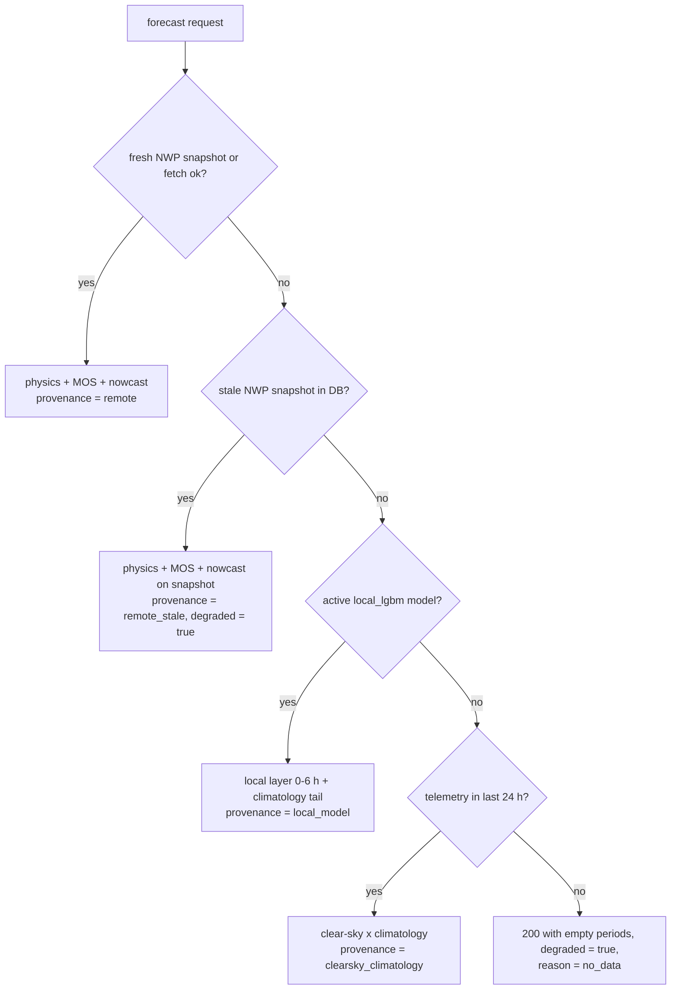

# Plan: local (sensor-only) forecast fallback

Status: proposed. Scope: backend + Home Assistant integration. No research artefacts change.

## 1. Goal

Keep producing a usable forecast when remote weather data is unavailable, using only what
the installation already reports: inverter power telemetry plus sun geometry.

Concretely: `GET /api/v1/systems/{id}/forecast` must return 200 with real numbers when
Open-Meteo is unreachable, the API key is invalid, the provider is down, or the home has no
internet at all — and it must say which source produced the numbers.

Non-goals:

- No new mandatory sensors. The feature works for every existing user with power telemetry.
- No change to remote-path accuracy. The native payload only gains fields; the
  Forecast.Solar-compatible route stays byte-identical.
- No cloud imagery, no per-site hyperparameter UI, no day-ahead accuracy claims.

## 2. Evidence this design is built on

From `research/local_sensors/RESULTS.md` (six sites, four continents, no online data):

| Finding | Number |
|---|---|
| Skill vs power persistence, power-only model, 60 min | 0.27 - 0.69 across sites |
| Skill at 180 / 360 min | 0.46 - 0.86 / 0.50 - 0.92 |
| Skill at 1440 min | -0.38 - 0.13 (collapse) |
| Gain from **all** extra sensors over power alone, 60 min | 0.7 - 6.8 %, median 2.2 % |
| Radiation sensor used **instead of** power | 93 - 121 % of the power-only error |

Two consequences drive the plan:

1. A power-only model is the right first implementation — it captures ~98 % of the
   achievable gain and needs no schema change (telemetry today stores power only).
2. The forecast must stop claiming accuracy beyond ~6 hours and degrade explicitly, not
   silently, past that point.

## 3. Where the current pipeline breaks

`app/core/pipeline.py`:

- `ForecastPipeline.ensure_weather()` re-raises when the fetch fails and no snapshot exists.
  Every caller (`compute_layers`, `get_forecast`, `snapshot_*`) therefore fails.
- `compute_layers()` builds `weather` first and passes it to `simulate_system`,
  `mos.build_features`, `clearsky_ghi`, `simulate_clearsky`.
- The `hybrid` (MOS) and `final` (nowcast) layers both consume NWP-derived series, so they
  cannot run without weather either.
- `clearsky.simulate_clearsky(index, system, horizon, ...)` is the one simulation that needs
  no weather — only a time index — and is already used by calibration and the nowcast.

So the failure is a single point: weather acquisition. The fix is a second, weather-free
way to fill the same `SimResult` carrier, not a parallel payload pipeline.

## 4. Design

### 4.1 New module: `app/core/accuracy/local_model.py`

Trains and serves a LightGBM model per system that predicts AC power from local history.

- **Inputs**: `actual_telemetry` (15- or 60-minute rows, resampled to 15 minutes), system
  geometry (`PlaneConfig`, `InverterConfig`), and clear-sky geometry from
  `clearsky.simulate_clearsky`.
- **Target**: `pac(t + h) / p_max` per horizon bucket `h in {15, 30, 45, 60, 90, 120, 180,
  240, 300, 360}` minutes — one small model per bucket, as in the research protocol.
  `p_max` = 99.9th percentile of the last 30 days of non-curtailed telemetry, stored in the
  model metadata; falls back to `inverter_kw * 1000` when telemetry is thin.
- **Features** (22, all available today):
  - geometry: `zenith`, `azimuth`, `poa_cs_t`, `poa_cs_h` (at the horizon), `doy_sin`,
    `doy_cos`, `tod_sin`, `tod_cos`, `clim_k`
  - power: `p_t`, `p_r30`, `p_r60`, `p_s60`, `p_d15`, `p_d60`, `k_t`, `k_r60`
  - calendar/regime: `is_weekend` is deliberately excluded; `clim_k` is the per-(month,
    15-minute-slot) median of the dimensionless clear-sky index learned on the training
    part only.
  - `a_eff` (array conversion factor, m2) is estimated on training rows with `poa_cs > 500`
    at the 95th percentile, exactly as the harness does; it makes `k_t` dimensionless.
- **Reuse from the harness**: the feature builder is reimplemented in the app (~150 lines,
  no dependency on `research/`), and a regression test pins it against golden values
  exported from `research/local_sensors/features.py` on a fixture so the two cannot drift.

### 4.2 Local layer construction

`local_model.apply(...)` returns a normal `SimResult`:

1. `base = simulate_clearsky(grid, system, horizon, shading=lookup, calibration_c=calibration_c)`
   — gives pdc/pac/zenith/elevation/planes on the requested grid.
2. Predict `pac` per horizon bucket on a 15-minute grid from "now" to `+360 min`; clamp to
   `[0, paco]`; feed through `_with_pac(base, local_pac)` (existing helper).
3. **Tail (> 360 min)**: `pac_tail = a_eff * poa_cs * clim_k`, i.e. climatological clear-sky
   index. Keep it, because HA energy/automation cards expect a 7-day shape, but mark every
   period `confidence: "low"` and expose `local_horizon_minutes: 360` so callers know where
   accuracy ends.
4. The nowcast delta layer is **not** applied on top: the local model already ingests the
   last 60 minutes of telemetry, and stacking `nowcast.apply` would double-count persistence.
   `layers_active["nowcast"]` stays false, `layers_active["local"]` becomes true.

### 4.3 Fallback chain



Tier 2 keeps today's behaviour (`ensure_weather` already falls back to a stale snapshot).
Tiers 3-5 are new. Tier 5 returns 200 with an explicit reason instead of an exception:
the integration can render "waiting for data" and automations can branch on `degraded`,
which is friendlier than a 503 in a recursive 5-minute poll.

### 4.4 Training, gating, registry

Mirrors `app/core/accuracy/mos.py`:

- `train(db, system_row, system, horizon, models_dir) -> dict | None`
- Training rows: telemetry from the last `local_train_days` (default 180), only
  non-curtailed rows, only rows with `poa_cs > 20 W/m2` and a complete feature set.
- Minimum data: `local_min_days` distinct days (default 14) with >= 50 daylight rows.
  Below that, return `None` (tier 4 stays in charge).
- **Gate** (same convention as MOS): hold the last 20 % of days as holdout; compare NMAE of
  the local model against the clear-sky x climatology baseline. Register only if
  `nmae_model <= GATE_RATIO * nmae_baseline`; otherwise deactivate and keep any previous
  model that still passes. Registry columns are reused unchanged:
  - `model_type = "local_lgbm"`
  - `holdout_nmae_physics` ← baseline NMAE (documented in the migration note)
  - `holdout_nmae_hybrid` ← local model NMAE
- Artifact: `models/{system_id}_local_{trained_at}.joblib` containing
  `{"models": {h: LGBMRegressor}, "features": [...], "p_max": float, "a_eff": float,
    "trained_at": int, "holdout_days": int}`.

### 4.5 API contract (additive only)

`app/schemas/native.py`:

| Field | Where | Meaning |
|---|---|---|
| `provenance: Literal["remote","remote_stale","local_model","clearsky_climatology","none"]` | `ForecastOut` | which tier produced the payload |
| `degraded: bool` | `ForecastOut` | true for every tier except `remote` |
| `reason: str \| None` | `ForecastOut` | why, when degraded (e.g. `remote_unavailable`, `no_telemetry`, `local_horizon_passed`) |
| `local_horizon_minutes: int` | `ForecastOut` | 360 in local mode, 0 otherwise |
| `confidence: Literal["high","low"]` | `PeriodOut` | `low` for periods beyond the local horizon and for the climatology tail |
| `local: bool`, `local_skill_60: float \| None` | `LearningOut` | model present, and its holdout skill vs baseline |

`layers_active` gains `"local"`.

`weather_fetched_at` keeps its type and meaning "timestamp of the weather data that was
used": in tier 2 it is the stale snapshot time, in tiers 3-5 it is the generation time. No
client should infer freshness from it alone — that is what `provenance` and `degraded` are
for. (Nothing in the HA integration parses this field; it reads `layers_active` and
`learning`, which is why the extra keys are safe there.)

The Forecast.Solar-compatible route (`app/api/routes_compat.py`) is **not** touched:
`tests/test_api_compat.py` asserts an exact key set for `message.info`, and third-party
clients bind to that shape. Provenance is a native-API concept, and the Home Assistant
integration already talks to `/api/v1/...` (`custom_components/solarcast/api.py`), so the
feature is fully usable from HA without any change to the compat contract.

### 4.6 Opt-in

- Global: `Settings.enable_local_forecast: bool = True`,
  `local_forecast_hours: int = 6`, `local_train_days: int = 180`,
  `local_min_days: int = 14`.
- Per system: new column `systems.local_fallback INTEGER NOT NULL DEFAULT 1`, exposed as
  `local_fallback: bool` on `SystemIn`/`SystemOut` and in the HA integration options.
  A user who does not want a modelled fallback can turn it off per installation; the
  global flag turns it off everywhere.

### 4.7 Scheduling and ongoing measurement

- `nightly_retrain` (01:30, existing) trains `local_lgbm` in the existing process pool
  right after MOS, so one job owns all learning.
- New job `local_shadow_snapshot` (every 60 minutes at :40): when the remote path is healthy,
  also compute the local layer and store it in `forecast_runs` with `source='local'`.
  That yields an ongoing, per-installation skill check against telemetry with zero user
  configuration, and it is what makes the gate trustworthy over time.
- `chat`-visible status: `GET /api/v1/health` adds `local_models: [{system_id, trained_at,
  holdout_nmae, skill_60}]`.

## 5. Data model

One migration in `app/core/database.py`, following the existing version-gated pattern in
`_init_sync()` (currently `SCHEMA_VERSION = 2`, with an `if version < 2:` block that adds a
column and backfills it):

1. bump `SCHEMA_VERSION` to `3`;
2. add

```python
if version < 3:
    columns = {row[1] for row in conn.execute("PRAGMA table_info(systems)")}
    if "local_fallback" not in columns:
        conn.execute(
            "ALTER TABLE systems ADD COLUMN local_fallback INTEGER NOT NULL DEFAULT 1"
        )
```

`tests/test_database_migration.py` is extended to build a v2 database and assert the v3
upgrade preserves rows and defaults to enabled.

No other schema change: `model_registry` and `forecast_runs` already support the new
`model_type` and `source` values.

## 6. Files

| File | Change |
|---|---|
| `app/core/accuracy/local_model.py` | new: features, train, gate, load, apply |
| `app/core/pipeline.py` | `compute_layers` gains the tier chain; new `_local_layers()`; `snapshot_local()` |
| `app/core/database.py` | `SCHEMA_VERSION = 3` + v3 migration, `local_fallback` in upsert/read (`active_model` is already generic) |
| `app/jobs/scheduler.py` | train local model in `retrain_system`; add `local_shadow_snapshot` job |
| `config/settings.py` | four new settings |
| `app/schemas/native.py` | `provenance`, `degraded`, `reason`, `local_horizon_minutes`, `PeriodOut.confidence`, `LearningOut.local*` |
| `app/api/routes_systems.py` | pass `local_fallback` through PUT/GET |
| `app/api/routes_health.py` | local model status |
| `custom_components/solarcast/config_flow.py`, `const.py`, `sensor.py`, `diagnostics.py` | option + provenance attribute + diagnostics |
| `docs/API.md`, `docs/VERIFICATION.md`, `README.md` | contract + scenario |
| `tests/test_local_model.py`, `tests/test_local_fallback.py` | new |

## 7. Acceptance criteria

1. With `OPENMETEO_BASE_URL` pointed at a closed port and no weather snapshot in the DB,
   `GET /forecast` returns 200, `provenance="local_model"`, `degraded=true`, and
   `periods` covering 6 hours with `confidence="high"`.
2. Same call on a system with 3 days of telemetry returns `provenance="clearsky_climatology"`
   (tier 4) and `degraded=true`, never a 5xx.
3. Local model holdout skill at 60 minutes is >= 0.20 on every research site fixture used in
   tests, and the model is not registered when the gate fails.
4. `local_fallback=false` restores the previous failure behaviour (503/500 path unchanged)
   and the training job skips the system.
5. Remote path unchanged: for a healthy installation the native payload differs only by
   additive fields, and the compat route (`/estimate/...`) stays byte-identical — the
   existing exact-key-set assertions in `tests/test_api_compat.py` must pass untouched.
6. Feature builder matches the research harness on a golden fixture (max abs difference
   `1e-6`).
7. No request-handling path blocks on training: training stays in the process pool.

## 8. Tests

- `tests/test_local_model.py`
  - feature alignment: target at `t` equals telemetry power at `t+h`
  - no look-ahead: mutating rows after `t` does not change features at `t`
  - `p_max`/`a_eff` computed from training rows only
  - gate rejects a model that is worse than the baseline; keeps the previous model
  - minimum-data rule returns `None` under 14 days
  - golden-feature comparison against the research harness export
- `tests/test_local_fallback.py`
  - tier chain: fresh -> stale -> local -> climatology -> none (monkeypatched weather)
  - `provenance`/`degraded`/`reason`/`confidence` in the payload and in the compat route
  - per-system toggle and global flag
  - local layer returns a `SimResult` whose `pac` is within `[0, paco]` and whose index
    matches the requested grid
  - shadow snapshot writes `source='local'` rows without touching the remote cache
- Existing suites must stay green; `tests/test_api_native.py` and `test_api_compat.py`
  snapshots updated for additive fields only.

## 9. Rollout

1. **Shadow**: ship training + shadow snapshot, feature flag off. Collect per-installation
   skill for a week; compare with research expectations (0.27-0.69 at 60 min).
2. **Fallback on**: `enable_local_forecast=true`, per-system opt-out available. Publish
   `provenance` in the integration so users can see when they are on the local model.
3. **Integration polish**: HA sensor attribute `forecast_provenance`, diagnostics block,
   option in the config flow.

Rollback at any point: set `enable_local_forecast=false`; registered models stay on disk but
are never loaded, and the previous failure path returns unchanged.

## 10. Risks and mitigations

| Risk | Mitigation |
|---|---|
| Local model silently degrades (sensor drift, array change) | Nightly gate against the climatology baseline; deactivate on failure; shadow snapshot keeps measuring |
| Wrong `p_max` after an array extension | Recompute nightly from the last 30 days; clamp predictions to `paco` |
| Users read the 7-day shape as accurate | `confidence: low` beyond 6 h, `local_horizon_minutes` in payload, HA attribute, docs |
| Winter/snow coverage | Training only on rows with `poa_cs > 20`; snow simply is not modelled — documentation says so |
| Duplicate persistence correction | Local mode disables the nowcast delta and feeds recent telemetry as features instead |
| Cold start confusion | Tier 4 returns a clear-sky shape with `provenance="clearsky_climatology"` and the reason, plus a health indicator "collecting data: 3/14 days" |

## 11. Follow-up (not in this plan)

Optional sensor channels (irradiance, ambient temperature, humidity) need telemetry schema
and ingest changes. Research says their total value at one hour is 0.7-6.8 % (median 2.2 %)
on top of power, so this is deliberately deferred and only worth doing if users report a
system where power telemetry is unreliable (indirect metering, clipped inverter data).

## 12. Verification commands

```bash
cd backend
uv run pytest tests -q
uv run pytest tests/test_local_model.py tests/test_local_fallback.py -q
# manual: no remote weather at all
OPENMETEO_BASE_URL=http://127.0.0.1:9 uv run uvicorn app.main:app --port 8000 &
curl -s localhost:8000/api/v1/systems/home/forecast | jq '{provenance, degraded, reason, local_horizon_minutes}'
```

## 13. Implementation notes (as built)

Where the code differs from the draft above, the code is the record:

- **Clear-sky reference** is the physics engine (`clearsky.simulate_clearsky`), not
  pvlib plane-of-array irradiance. That removes the aperture (`a_eff`) estimate
  entirely: the model's target is `pac / p_max` and its reference is the clear-sky
  `pac`, so tilt, azimuth, losses and calibration are already inside the physics
  chain. `clim_k` is the median of `actual / clear` per (month, 15-minute slot).
- **Per-horizon gate**, not an aggregate one: each bucket is published only if it
  beats the clear-sky x climatology curve on the holdout by `GATE_RATIO` (5%),
  with 60 minutes mandatory and at least three buckets required. The published
  horizon is therefore `max(accepted)`, which is what `local_horizon_minutes`
  reports; on synthetic data it lands at 120-360 minutes depending on history.
- **`layers_active` is unchanged** (four keys), because the compat route asserts an
  exact key set. Locality is exposed through `provenance`, `degraded`,
  `reason` and `learning.local` instead.
- **Training runs inside the nightly job** via `asyncio.to_thread` rather than the
  MOS process pool: ten small forests over at most a few thousand rows finish in
  a couple of seconds.
- **Schema**: `SCHEMA_VERSION` 3 adds `systems.local_fallback`; `active_model` now
  filters by `model_type`, which also fixes a latent bug where a newer local model
  could be handed to the MOS loader.
- **Tier 4 without a model** uses a scalar clear-sky index learned from the last
  six hours of telemetry (median of `actual / clear`), so the cold-start payload is
  still installation-specific.

